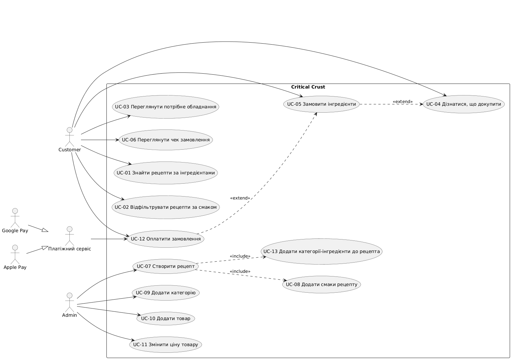

# Use Case діаграма

## Умови розширення (extend)

| Зв'язок | Умова |
|---|---|
| UC-05 → UC-04 | Користувач вирішив докупити інгредієнти, яких не вистачає для рецепта. |
| UC-12 → UC-05 | Користувач підтвердив оформлене замовлення й перейшов до оплати. |